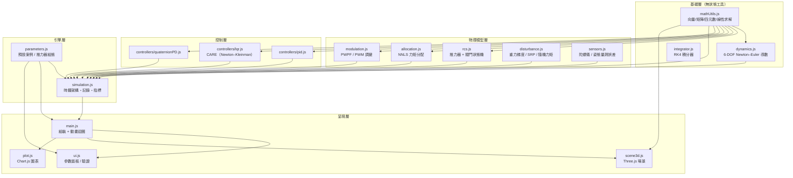

# 程式架構與資料流程

本文件說明模擬器的模組結構、一個控制週期內的資料流，以及各檔案的職責介面。數學模型詳見 [equations.md](equations.md)。

## 模組架構圖



### ASCII 對照版

```text
┌─────────────────── 基礎層 ───────────────────┐
│  mathUtils.js        V / M3 / Q / solveLinear  │
│  dynamics.js         純函數 derivative(s)        │
│  integrator.js       rk4Step                   │
└──────────────────────────────────────────────┘
                     ↓
┌─────────────────── 物理模型層 ────────────────┐
│  rcs.js          推力器・閥門狀態機・質量流率   │
│  allocation.js   Lawson–Hanson NNLS 分配       │
│  modulation.js   PWPF / PWM / 連續             │
│  disturbance.js  GG / SRP / 常值 / 隨機        │
│  sensors.js      感測雜訊與偏置                │
└──────────────────────────────────────────────┘
                     ↓
┌─────────────────── 控制層 ───────────────────┐
│  controllers/pid.js          τ = Kpδ − Kdω + Ki∫δ │
│  controllers/lqr.js          CARE → K          │
│  controllers/quaternionPD.js τ = 2Kp·qe − Kdω  │
└──────────────────────────────────────────────┘
                     ↓
┌─────────────────── 引擎層 ────────────────────┐
│  simulation.js   時鐘・步進・記錄・指標          │
│  parameters.js   三個預設案例                   │
└──────────────────────────────────────────────┘
                     ↓
┌─────────────────── 呈現層 ────────────────────┐
│  main.js   組裝・requestAnimationFrame 迴圈     │
│  ui.js     宣告式參數面板・驗證・案例匯出入      │
│  scene3d.js  Three.js 3D 場景                   │
│  plot.js   Chart.js 圖表（縮放/提示/相圖）       │
└──────────────────────────────────────────────┘
```

## 一個控制週期的資料流程

模擬採**雙時鐘架構**：控制器以 `controlPeriod` 取樣（感測器估計、控制律更新）；物理積分以步長 `dt` 前進，且**調變器與閥門在每個物理步都會更新**（PWPF 濾波器連續積分、PWM 相位連續推進）。每個物理步內執行以下流程：

```mermaid
flowchart LR
    S["狀態 s<br/>(r, v, q, ω, m_prop)"] --> SEN["感測器 sensors.js<br/>加入雜訊/偏置"]
    SEN --> CTRL["控制律<br/>PID / LQR / QPD"]
    CTRL -->|"τ_cmd [N·m]"| MOD["調變器 modulation.js<br/>PWPF/PWM → τ_m"]
    MOD -->|"τ_m"| ALLOC["分配器 allocation.js<br/>NNLS：τ_m → f（各推力器推力）"]
    ALLOC -->|"f > 1% 滿推力 → 0/1 指令"| VALVE["閥門狀態機 rcs.js<br/>延遲・最小衝量・占空比"]
    VALVE -->|"實際 ON/OFF → τ_B, F_B, ṁ"| DYN["動力學 dynamics.js<br/>ẋ = f(s, τ, F)"]
    DYN --> INT["RK4 integrator.js<br/>s(t+dt)"]
    INT --> REC["記錄（recordInterval 取樣）"]
    INT --> S
```



各階段重點：

| 階段 | 輸入 | 輸出 | 備註 |
|---|---|---|---|
| 感測器 | 真實 q, ω | 估計 q̂, ω̂ | 雜訊以取樣間隔離散化注入 |
| 控制律 | q̂, ω̂, q_target, 飽和資訊 | τ_cmd（body 系） | PID 含條件積分抗飽和 |
| 調變器 | τ_cmd（正規化 u = τ/τ̂） | 調變後力矩請求 τ_m | PWPF 輸入已正規化，門檻為容量百分比 |
| 分配器 | τ_m | 各推力器推力 f | Lawson–Hanson NNLS + 飽和迭代 |
| 閥門 | 0/1 指令（f > 1% 滿推力即要求開） | 實際 ON/OFF | t_min = I_min/F_max；滑動視窗占空比 |
| 動力學 | s, τ_B, F_B | ds/dt | ṁ = −ΣF/(Isp·g₀) 同步積分 |
| 記錄 | s, τ | 圖表資料 | 錯誤四元數、Euler、推進劑、Δv |

## 檔案職責介面表

| 檔案 | 職責 | 主要匯出 | 使用者 |
|---|---|---|---|
| `js/mathUtils.js` | 向量/矩陣/四元數運算、Gauss 求解、種子化 RNG | `V, M3, Q, solveLinear, makeRng` | 幾乎所有模組 |
| `js/dynamics.js` | 6-DOF 純函數導數、能量/角動量工具 | `derivative, rk4Step 相關, G0` | integrator, simulation |
| `js/integrator.js` | RK4 步進（閥門狀態跨階段固定） | `rk4Step` | simulation |
| `js/rcs.js` | 推力器模型、閥門狀態機、RCS 群組 | `RcsSystem, Valve, makeThruster, minOnTime` | simulation |
| `js/allocation.js` | NNLS 力矩分配、容量計算、可控性檢查 | `allocate, buildMatrices, axisTorqueCapacity` | simulation |
| `js/modulation.js` | PWPF/PWM 調變、連續模式 | `Pwpf, Modulator` | simulation |
| `js/disturbance.js` | 擾動力矩合成 | 模組函式 | simulation |
| `js/sensors.js` | 感測誤差注入 | 模組函式 | simulation |
| `js/controllers/pid.js` | PID 控制律 | `PidController` | simulation |
| `js/controllers/lqr.js` | LQR：線性化 + CARE 疊代解 | `LqrController, solveCare, linearize` | simulation |
| `js/controllers/quaternionPD.js` | 四元數 PD | `QuaternionPdController` | simulation |
| `js/simulation.js` | 引擎：時鐘、步進、記錄、指標 | `Simulation` | main |
| `js/parameters.js` | 預設案例與推力器組態 | `PRESETS, presetByName, defaultConfig` | main, ui |
| `js/ui.js` | 宣告式參數面板、驗證、案例匯出入 | `UI` | main |
| `js/scene3d.js` | Three.js 場景（火箭、推力器、軌跡） | `Scene3D` | main |
| `js/plot.js` | Chart.js 圖表管理 | `PlotManager` | main |
| `js/main.js` | 應用程式進入點與動畫迴圈 | —（入口） | index.html |

## 關鍵設計決策

- **四元數純量優先**（`[w, x, y, z]`），body→inertial；誤差四元數 `q⁻¹ ⊗ q_d` 為「前往目標的旋轉」，控制力矩取 `+Kp·δ − Kd·ω`。
- **錯誤方向防呆**：若極限環不收斂，先檢查誤差四元數方向與力矩符號（本專案開發時曾在此跌倒，詳見測試 T7 系列）。
- **閥門狀態在 RK4 各階段保持固定**：避免同一物理步內開關抖動造成積分不確定。
- **NNLS 而非偽逆**：純力偶配置下偽逆截斷只能達成 50% 力矩容量，NNLS 保證非負解的最優性。
- **調變器輸入正規化**：PWPF 門檻為軸容量百分比，跨案例不需重調。
